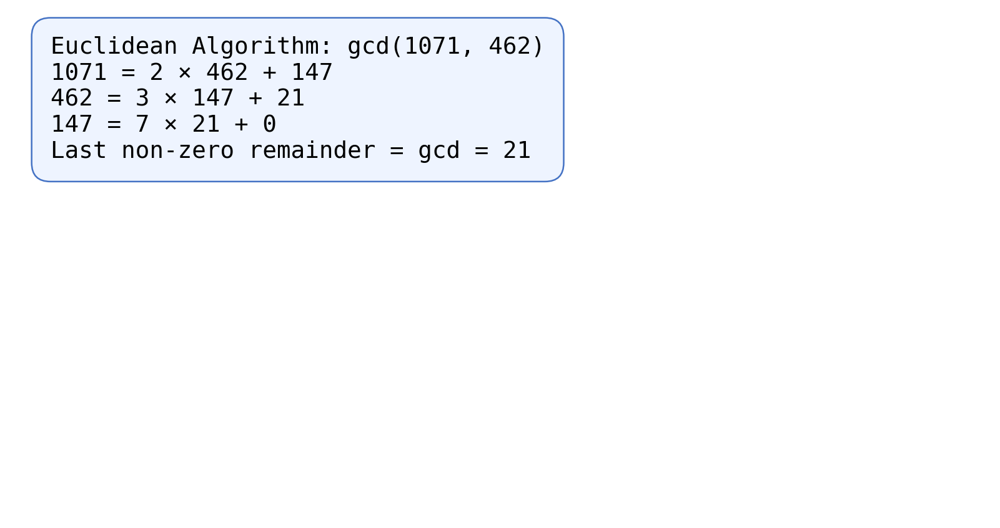
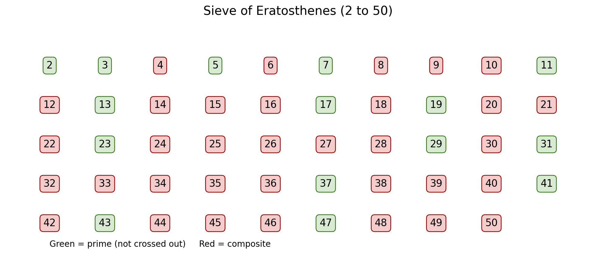

# Number Theory Assignment — Day 1 & Day 2

**Name:** Md. Shishir Kaysar Shuvon  
**Student ID:** `IT-23030`  
**Department:** ICT  
**University:** Mawlana Bhashani Science and Technology University (MBSTU)

---

## Table of Contents
- [Overview](#overview)
- [Repository Structure](#repository-structure)
- [How to Run](#how-to-run)
- [Day 1 — Number Theory and Modular Arithmetic](#day-1--number-theory-and-modular-arithmetic)
- [Day 2 — Prime Numbers](#day-2--prime-numbers)
- [Complexity Summary](#complexity-summary)
- [Observations](#observations)
- [Limitations and Accuracy Notes](#limitations-and-accuracy-notes)
- [References](#references)

## Overview

This repository contains study notes, mathematical explanations, executable Python examples, and visual aids based on the supplied Day 1 and Day 2 lecture slides. All code is intended to run in Google Colab or a local Jupyter Notebook.

## Repository Structure

```text
Number-Theory-Assignment/
├── README.md
├── notebooks/
│   ├── Day_1_Number_Theory.ipynb
│   └── Day_2_Prime_Numbers.ipynb
├── src/
│   └── number_theory.py
└── figures/
    ├── euclidean_algorithm.png
    └── sieve_of_eratosthenes.png
```

## How to Run

### Google Colab
1. Upload the two `.ipynb` files from `notebooks/` to Google Drive.
2. Right-click a notebook and choose **Open with → Google Colaboratory**.
3. Run cells from top to bottom using **Runtime → Run all**.
4. Check that the displayed outputs match the examples in the notebook.

### Local Jupyter
```bash
python3 -m pip install jupyter
jupyter notebook
```
Open either notebook and select **Kernel → Restart & Run All**.

The notebooks use Python's standard library only; no third-party package is required.

---

# Day 1 — Number Theory and Modular Arithmetic

## 1. Greatest Common Divisor

The greatest common divisor, `gcd(a,b)`, is the largest positive integer dividing both `a` and `b`. Euclid's algorithm repeatedly applies:

\[
\gcd(a,b)=\gcd(b,a\bmod b).
\]

```python
def gcd(a, b):
    a, b = abs(a), abs(b)
    while b:
        a, b = b, a % b
    return a

print(gcd(24, 16))  # 8
```

**Complexity:** \(O(\log(\min(|a|,|b|)))\) time and \(O(1)\) auxiliary space.

## 2. Least Common Multiple

For positive integers:

\[
\operatorname{lcm}(a,b)\operatorname{gcd}(a,b)=ab,
\qquad
\operatorname{lcm}(a,b)=\frac{|ab|}{\operatorname{gcd}(a,b)}.
\]

```python
def lcm(a, b):
    if a == 0 or b == 0:
        return 0
    return abs(a // gcd(a, b) * b)

print(lcm(24, 16))  # 48
```

## 3. Extended Euclidean Algorithm

It finds Bézout coefficients \(x,y\) satisfying:

\[
ax+by=\gcd(a,b).
\]

The coefficients are useful in solving integer equations and finding modular inverses. The implementation is in `src/number_theory.py` and in the Day 1 notebook.

## 4. Linear Diophantine Equations

A linear Diophantine equation is:

\[
ax+by=c,\quad x,y\in\mathbb Z.
\]

It has an integer solution if and only if:

\[
\gcd(a,b)\mid c.
\]

If \(d=\gcd(a,b)\), \(a=dp\), \(b=dq\), and \((x_0,y_0)\) is one solution, all solutions are:

\[
x=x_0+tq,\qquad y=y_0-tp,\qquad t\in\mathbb Z.
\]

The notebook implements the Extended Euclidean Algorithm and constructs one solution when it exists.

## 5. Modular Arithmetic and Modular Division

\[
a\equiv b\pmod n \iff n\mid(a-b).
\]

A multiplicative inverse of \(a\) modulo \(n\) is an integer \(u\) such that:

\[
au\equiv1\pmod n.
\]

An inverse exists exactly when \(\gcd(a,n)=1\). For example, the inverse of 2 modulo 9 is 5 because \(2\cdot5=10\equiv1\pmod9\). Therefore:

\[
\frac72\equiv7\cdot5\equiv8\pmod9.
\]

## 6. Chinese Remainder Theorem

If the moduli \(n_1,\ldots,n_k\) are pairwise coprime, the system of congruences has a unique solution modulo \(N=n_1n_2\cdots n_k\). The notebook includes a two-modulus implementation.

## 7. Fast Modular Exponentiation

Repeated squaring computes \(b^e\bmod m\) without constructing the huge integer \(b^e\). Its time complexity is \(O(\log e)\).

```python
def mod_pow(base, exponent, modulus):
    result = 1
    base %= modulus
    while exponent > 0:
        if exponent & 1:
            result = result * base % modulus
        base = base * base % modulus
        exponent >>= 1
    return result

print(mod_pow(7, 13, 11))  # 2
```

## 8. Fermat's Little Theorem

If \(p\) is prime and \(p\nmid a\), then:

\[
a^{p-1}\equiv1\pmod p.
\]

Its converse is not generally true: composite numbers can pass a Fermat test for selected bases.

## 9. Euler's Totient Function

\(\phi(n)\) counts the residues coprime to \(n\). For prime \(p\), \(\phi(p)=p-1\). If \(n=\prod p_i^{a_i}\), then:

\[
\phi(n)=n\prod_{p\mid n}\left(1-\frac1p\right).
\]

## 10. Euler's Theorem

If \(\gcd(a,n)=1\), then:

\[
a^{\phi(n)}\equiv1\pmod n.
\]

It generalizes Fermat's Little Theorem and is relevant to RSA together with modular exponentiation. The notebook demonstrates the theorem, not a secure cryptographic system.

---

# Day 2 — Prime Numbers

## 1. Prime Number Definition and Trial Division

A prime is a natural number greater than 1 with no positive divisors other than 1 and itself. Trial division only needs to test possible divisors up to \(\sqrt n\), giving \(O(\sqrt n)\) time.

## 2. Infinitely Many Primes

Euclid's proof assumes a finite list \(p_1,\ldots,p_k\) and considers \(N=p_1p_2\cdots p_k+1\). No listed prime divides \(N\), contradicting the assumption that the list contained every prime. The notebook explains the proof conceptually.

## 3. Prime Distribution

Let \(\pi(x)\) denote the number of primes not exceeding \(x\). The Prime Number Theorem states:

\[
\pi(x)\sim\frac{x}{\log x}.
\]

Dirichlet's theorem states that if \(\gcd(a,b)=1\), there are infinitely many primes of the form \(ak+b\). These are theoretical results; the notebook compares a finite prime count with the PNT estimate.

## 4. Prime Conjectures

The slides introduce Goldbach's conjecture, the twin-prime conjecture, Waring's prime number conjecture, Chebyshev's bias, primes between consecutive squares and prime spirals. A finite program can test examples over a bounded range, but cannot prove an infinite conjecture.

The polynomial \(n^2+n+41\) produces primes for \(n=0,\ldots,39\), but it does not produce primes for every integer.

## 5. Sieve of Eratosthenes

The sieve marks multiples of each prime beginning at its square. The unmarked integers are prime.

**Complexity:** \(O(n\log\log n)\) time and \(O(n)\) space.

## 6. Pseudoprimes and Carmichael Numbers

Fermat's test checks \(a^{n-1}\equiv1\pmod n\) for bases coprime to \(n\). Passing the test does not prove primality. Carmichael numbers are composite integers satisfying \(a^n\equiv a\pmod n\) for every integer \(a\); examples in the lecture include 561, 1105 and 1729.

## 7. Primitive Roots and Multiplicative Order

The multiplicative order of \(a\) modulo \(n\) is the smallest positive \(k\) for which \(a^k\equiv1\pmod n\), when \(\gcd(a,n)=1\). A primitive root has order \(\phi(n)\).

## 8. Lucas and Related Primality Tests

The slides state a Lucas criterion based on the prime factors of \(n-1\), and mention the \(n-1\) test, Pepin's test, Proth's theorem, Lucas–Lehmer test and \(n+1\) tests. These advanced criteria are described in the notebook; not all are implemented.

## 9. Mersenne Primes and Lucas–Lehmer Test

A Mersenne number is \(M_p=2^p-1\). For prime \(p>2\), the Lucas–Lehmer sequence is:

\[
s_0=4,\qquad s_{i+1}=s_i^2-2.
\]

\(M_p\) is prime exactly when \(s_{p-2}\equiv0\pmod{M_p}\). The notebook implements this test for small prime exponents.

## 10. Perfect Numbers

A perfect number equals the sum of its positive proper divisors. The first examples are 6, 28, 496 and 8128. The notebook computes proper-divisor sums and checks these examples.

## 11. Antiprimes / Highly Composite Numbers

A highly composite number has more positive divisors than every smaller positive integer. If \(n=\prod p_i^{a_i}\), its divisor count is:

\[
d(n)=\prod_i(a_i+1).
\]

The notebook computes divisor counts and lists record-holders up to a chosen limit.

## 12. Fundamental Theorem of Arithmetic and Applications

Every integer greater than 1 has a unique prime factorization, up to the order of factors. The lecture connects prime numbers with number-theoretic functions, modular arithmetic, cryptography, rings and algebraic number theory.

---

## Complexity Summary

| Algorithm | Time complexity | Extra space |
|---|---:|---:|
| Euclid GCD | \(O(\log(\min(a,b)))\) | \(O(1)\) |
| Extended Euclid | \(O(\log(\min(a,b)))\) | \(O(\log(\min(a,b)))\) recursion |
| LCM using GCD | \(O(\log(\min(a,b)))\) | \(O(1)\) |
| Fast modular exponentiation | \(O(\log e)\) | \(O(1)\) |
| Trial-division primality | \(O(\sqrt n)\) | \(O(1)\) |
| Sieve of Eratosthenes | \(O(n\log\log n)\) | \(O(n)\) |
| Divisor count (simple loop to √n) | \(O(\sqrt n)\) | \(O(1)\) |

## Observations

1. Efficient number-theory algorithms avoid unnecessary large intermediate values.
2. Extended Euclid links GCD, Diophantine equations and modular inverses.
3. Repeated squaring makes modular exponentiation practical for large exponents.
4. A primality test based on a necessary condition may identify composites when it fails, but passing does not always prove primality.
5. A finite computational experiment supports examples, not an infinite mathematical proof.

## Limitations and Accuracy Notes

- The notebooks are educational implementations, not optimized cryptographic libraries.
- Fermat tests with a few bases are only demonstrations and must not be used to certify large primes.
- Conjectures such as Goldbach and twin primes are not presented as proven.
- Advanced tests named in the slides are identified, but not all are coded.
- The code uses Python's arbitrary-precision integers and standard library.

## References

1. **Day 1.pdf** — lecture slides supplied for this assignment.
2. **Day 2.pdf** — lecture slides supplied for this assignment.

## Figures

### Euclidean Algorithm


### Sieve of Eratosthenes

